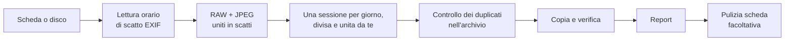

# ImportaMI

[English](README.md) · **Italiano**

ImportaMI copia foto e video da una scheda SD o da un disco esterno al computer e li archivia
in una cartella per ogni **sessione di scatto**: un matrimonio, un carnevale, un concerto.
Funziona su Windows, macOS e Linux.

> **Stato: prima versione completa, in prova.** Tutto il flusso funziona: scansione, sessioni, destinazione, copia verificata,
> report e pulizia della scheda. È stata provata su Windows; la tabella [Stato](#stato) dice cosa resta da provare.

## Cosa fa

Colleghi la scheda e, invece di una cartella `DCIM\100EOSR6` con 1.200 file tutti insieme, ottieni questo:

```text
D:\Foto
└─ 2026
   ├─ 2026-09-27 Matrimonio Bianchi
   │  ├─ Foto    296 file
   │  └─ Video     4 file
   ├─ 2026-09-27 Sfilata di carnevale
   │  └─ Foto    188 file
   └─ 2026-10-02 Concerto
      ├─ Foto    340 file
      └─ Video     6 file
```



I cinque passaggi dell'app:

1. **Sorgente**: schede e dischi esterni compaiono appena li colleghi, oppure scegli una cartella qualsiasi.
2. **Sessioni**: controlli le sessioni, le dividi o le unisci, dai un nome a ciascuna e vedi quali foto hai già.
3. **Destinazione**: dove salvare, quali formati, come organizzare le cartelle.
4. **Copia e report**: copia verificata con avanzamento, poi un report che puoi aprire anche in CSV.
5. **Pulizia scheda**: facoltativa, elimina dalla scheda solo ciò che è al sicuro sul computer.

## Come vengono catalogate le foto

### 1. L'orario viene dall'EXIF

Ogni file viene datato con l'**orario di scatto EXIF** (`DateTimeOriginal`), scritto dalla fotocamera nel momento dello scatto.
Le date dei file non vengono usate, perché cambiano quando i file vengono copiati o modificati.
Per i video si usa l'orario di creazione scritto nell'intestazione MP4 o MOV.
Solo quando un file non ha un orario di scatto leggibile ImportaMI usa la data del file, e ti dice quali file.

L'orario è preso esattamente come l'ha registrato la fotocamera, senza fuso orario: le date nei nomi delle cartelle seguono l'orologio della fotocamera.

### 2. I file dello stesso clic diventano un solo scatto

Una fotocamera impostata su RAW + JPEG scrive due file per ogni foto. I file nella **stessa cartella con lo stesso nome**
(senza contare estensione e maiuscole) sono trattati come un unico scatto:

| Sulla scheda | Scatto |
|---|---|
| `IMG_4012.CR3` + `IMG_4012.JPG` | 1 scatto, RAW e JPEG |
| `IMG_4013.CR3` | 1 scatto, solo RAW |
| `MVI_4501.MP4` | 1 scatto, video (i video non vengono mai abbinati alle foto) |

File supportati: RAW (CR2, CR3, NEF, NRW, ARW, RAF, ORF, RW2, PEF, SRW, DNG e altri), immagini già sviluppate
(JPEG, HEIF/HEIC, PNG, WebP, TIFF; nella scelta dei formati contano come "JPEG"), video (MP4, MOV, MTS, M2TS, AVI).

### 3. Sessioni: una per giorno, poi decidi tu

L'orario da solo non distingue un matrimonio da un carnevale fotografati nello stesso pomeriggio, quindi ImportaMI non tira a indovinare.
Parte da **una sessione per giorno** e ti lascia modellarle:

- **Dividi…** mostra tutte le foto della sessione. Clicchi la foto da cui inizia il servizio successivo
  (puoi sceglierne più di una), poi confermi.
- **Unisci alla precedente** attacca una sessione a quella prima, per esempio un concerto andato oltre la mezzanotte.
- Ogni sessione mantiene il nome che le hai dato mentre dividi e unisci, purché inizi ancora con la stessa foto.

Esempio:

| Foto sulla scheda | Proposta | Dopo le tue modifiche |
|---|---|---|
| dom 27 set, 10:30 → 12:05, matrimonio | 1 sessione per il 27 | **Matrimonio Bianchi** |
| dom 27 set, 15:30 → 15:31, carnevale | (stessa sessione) | divisa qui → **Sfilata di carnevale** |
| ven 2 ott, 23:35 → 23:58, concerto | 1 sessione per il 2 | **Concerto** |
| sab 3 ott, 00:20, fine del concerto | 1 sessione per il 3 | unita alla precedente |

### 4. Ogni sessione riceve un nome di cartella

Una sessione nuova non ha nome: ImportaMI non prova a indovinare cosa c'è nelle foto. Il nome lo dai tu.

- Il nome della cartella è `data + nome`, per esempio `2026-09-27 Matrimonio Bianchi`.
- Senza nome, la cartella usa solo la data, per esempio `2026-09-27`.
- I caratteri non ammessi nei nomi di cartella su Windows, macOS o Linux (`\ / : * ? " < > |`) diventano `_`,
  e spazi e punti finali vengono tolti: le stesse cartelle funzionano su tutti i sistemi.
- Due sessioni selezionate con lo stesso nome di cartella vengono segnalate: i loro file finirebbero insieme.

Scegli tu come annidare le cartelle:

| Struttura | Esempio |
|---|---|
| Data e nome | `2026-09-27 Matrimonio Bianchi` |
| Anno › data e nome | `2026\2026-09-27 Matrimonio Bianchi` |
| Anno › mese › data e nome | `2026\09\2026-09-27 Matrimonio Bianchi` |

Dentro ogni cartella di sessione scegli come dividere i file:

| Opzione | Dentro `2026-10-02 Concerto` |
|---|---|
| Tutto insieme | tutti i file |
| Foto e video separati | `Foto\` e `Video\` |
| RAW, JPEG e video separati | `RAW\`, `JPG\` e `Video\` |

I nomi delle sottocartelle seguono la lingua dell'interfaccia (`Photos` e `Videos` in inglese).

### 5. Le foto che hai già vengono riconosciute

Subito dopo la scansione ImportaMI cerca le foto della scheda nel tuo archivio (la cartella di destinazione),
**in qualsiasi sottocartella**, anche se sono state rinominate o se l'ultima volta avevi chiamato la sessione in un altro modo.

Il confronto è sul **contenuto**, mai sul nome o sulla data:

1. i candidati sono i file dell'archivio con esattamente la stessa dimensione in byte;
2. un candidato vale come copia solo se l'**impronta xxHash64 dell'intero file** è identica;
3. durante la copia il file intero viene confrontato ancora una volta prima di saltarlo.

Quindi due foto diverse con lo stesso nome non vengono mai confuse, e la stessa foto rinominata nell'archivio viene riconosciuta.
Una foto ritoccata, ridimensionata o risalvata è un file diverso e viene importata di nuovo.

Una sessione già importata per intero viene segnata **Già nel tuo archivio**, mostra dove è stata trovata e viene deselezionata.
Una sessione importata in parte mostra quanti scatti ci sono già; quei file vengono saltati durante la copia.
Un file con lo stesso nome ma contenuto diverso non viene mai considerato un duplicato.

### 6. Scegli quali formati copiare

| Scelta | Cosa viene copiato | Cosa resta sulla scheda |
|---|---|---|
| RAW + JPEG | tutti i file di ogni scatto | niente |
| Solo RAW | i file RAW | i JPEG |
| Solo JPEG | i JPEG | i RAW; gli scatti senza JPEG vengono saltati e segnalati |

I video hanno un interruttore a parte.

### 7. Copia e pulizia della scheda sono pensate per essere sicure

- Ogni file viene scritto con un nome temporaneo e rinominato solo quando il suo **checksum xxHash64** coincide con l'originale:
  una copia interrotta non lascia mai file a metà. La data originale del file viene mantenuta.
- Un file già presente nella destinazione con lo stesso contenuto viene saltato; un file diverso con lo stesso nome
  viene rinominato (`IMG_4012 (1).CR3`), mai sovrascritto, a meno che tu non scelga di sovrascrivere.
- Un file illeggibile viene saltato, elencato nel report e si può riprovare.
- La copia si può mettere in pausa e annullare. Se la scheda o la destinazione spariscono, o la destinazione è piena, la copia si ferma e dice perché.
- Un report CSV con l'esito di ogni file viene salvato nella cartella dei dati dell'app (vedi [Dove ImportaMI tiene i suoi dati](#dove-importami-tiene-i-suoi-dati)).
- La **pulizia della scheda** è un passaggio separato dopo il report e parte solo con la tua conferma. Elimina solo i file copiati
  e verificati (o trovati identici nell'archivio), e subito prima di eliminare ognuno ricontrolla l'hash della copia sul computer.
  I file protetti in fotocamera, quelli modificati dopo la copia, i formati non importati, le sessioni non selezionate
  e le cartelle di sistema della fotocamera restano sulla scheda.
- Alla fine la scheda si può espellere. **Nuova importazione** riporta al passo 1 con la stessa scheda selezionata
  e ti dice quanti file ci sono ancora sopra.

Le tue scelte (destinazione, formati, struttura, sottocartelle, opzioni) vengono ricordate per la volta successiva.

## Dove ImportaMI tiene i suoi dati

Nella cartella di destinazione finiscono solo foto e video. Impostazioni, report e log stanno nella
cartella dei dati locali dell'utente, in una cartella `ImportaMI`:

| Sistema | Cartella |
|---|---|
| Windows | `%LOCALAPPDATA%\ImportaMI` |
| macOS | `~/Library/Application Support/ImportaMI` |
| Linux | `~/.local/share/ImportaMI` |

| Contenuto | Cosa c'è |
|---|---|
| `settings.json` | Le tue scelte per la prossima importazione |
| `reports\report-aaaaMMgg-hhmmss.csv` | Uno per importazione: ogni file con esito, destinazione e checksum xxHash64 |
| `logs\importami-aaaaMMgg.log` | Uno al giorno: scansioni, controlli dell'archivio, copie, pulizie, espulsioni ed errori. Conservati 30 giorni |

Si usa una cartella per utente invece di ProgramData perché esiste ed è scrivibile su tutti e tre i sistemi,
e su un computer condiviso tiene separata la cronologia di ogni utente.

## Quando qualcosa non va

Una scheda vera è raramente perfetta. Niente di quanto segue ferma la scansione: i problemi vengono elencati sotto le sessioni, file per file.

| Situazione | Cosa fa ImportaMI |
|---|---|
| Chiavetta USB senza foto né video | Lo dice, e indica quanti altri file (documenti, musica…) ha trovato |
| Scheda o disco vuoti | Dice che sono vuoti |
| Scheda scollegata durante scansione, copia o pulizia | Si ferma e lo dice; quanto già fatto resta valido |
| Destinazione piena o scollegata durante la copia | Si ferma; dopo aver risolto, **Riprova** copia solo ciò che manca |
| Destinazione sulla scheda stessa | Rifiutata, con la spiegazione |
| Spazio insufficiente nella destinazione | La copia non parte; vengono mostrati spazio necessario e libero |
| Foto senza orario di scatto, o con metadati danneggiati | Usa la data del file, segnala la sessione ed elenca il file |
| RAW che la libreria dei metadati non sa leggere, accanto a un JPEG con lo stesso nome | Usa l'orario del JPEG, senza avvisi |
| File vuoto (0 byte), tipico di una scrittura interrotta | Lo salta e lo elenca |
| Cartella o file che non si possono aprire | Li salta e li elenca |
| File `._IMG_0001.JPG` di macOS sulle schede FAT ed exFAT | Li ignora: sembrano foto ma contengono solo dati del Finder |
| Cestini e cartelle di sistema (`$RECYCLE.BIN`, `.Trashes`, `System Volume Information`…) | Non ci entra |
| Collegamenti simbolici e junction | Non li segue, per evitare cicli |
| Unità di rete | Non vengono proposte: una scollegata bloccherebbe l'elenco |

## Lingue

L'interfaccia è disponibile in **italiano** e **inglese**. Segue la lingua del sistema operativo
e usa l'inglese per le altre lingue. Per forzarne una, avvia l'app con `--lang=it` o `--lang=en`.

Per aggiungere una lingua crea `src/ImportaMI.App/Resources/Strings.<codice>.resx`, poi aggiungi il codice a
`LanguageSelection.Supported` e a `SatelliteResourceLanguages` nel progetto dell'app.
Un test fallisce se in una traduzione manca un testo o ce n'è uno in più.

## Stato

| Area | Stato |
|---|---|
| Scansione, orari di scatto, abbinamento RAW + JPEG | Fatto, testato |
| Sessioni per giorno, divisione e unione cliccando le foto | Fatto, testato |
| Duplicati nell'archivio | Fatto, testato |
| Destinazione, formati, strutture e sottocartelle | Fatto, testato |
| Copia verificata, pausa, annulla, riprova, report CSV | Fatto, testato |
| Pulizia ed espulsione della scheda | Fatto, testato (espulsione provata solo su Windows) |
| Interfaccia in italiano e inglese | Fatto, testato |
| Windows | Provato |
| macOS e Linux | Compilato per loro, da provare su macchine vere |
| Orario dei file CR3 Canon senza JPEG gemello | Da verificare con schede vere |
| Miniature | Da JPEG, PNG e WebP, e dall'anteprima interna dei RAW basati su TIFF (NEF, ARW, CR2, DNG); CR3, HEIC, TIFF e video mostrano un segnaposto |
| Sessioni automatiche per contenuto (riconoscere un matrimonio da un carnevale) | Idea per una versione successiva: serve un modello di riconoscimento delle immagini |

Il flusso è anche nel [prototipo interattivo](docs/ui-prototype.html): scaricalo e aprilo nel browser.

## Tecnologie

- .NET 10 (LTS) e C#
- [Avalonia UI](https://avaloniaui.net/) 12 con tema Fluent
- CommunityToolkit.Mvvm
- [MetadataExtractor](https://github.com/drewnoakes/metadata-extractor-dotnet) per EXIF e metadati dei video
- System.IO.Hashing (xxHash64) per la verifica
- xUnit, e Avalonia Headless per i test dell'interfaccia

## Struttura del progetto

| Progetto | Contenuto |
|---|---|
| `src/ImportaMI.Core` | Scansione, sessioni, controllo archivio, copia, pulizia e impostazioni, senza dipendenze dall'interfaccia |
| `src/ImportaMI.App` | L'app desktop Avalonia (MVVM) e le traduzioni |
| `tests/ImportaMI.Core.Tests` | Test su file veri in cartelle temporanee: scansione, copia, duplicati, pulizia, traduzioni |
| `tests/ImportaMI.App.Tests` | L'app vera eseguita senza finestra su una scheda simulata, nelle due lingue, lungo tutto il flusso, con uno screenshot di ogni schermata |

## Compilare e avviare

Serve l'[SDK .NET 10](https://dotnet.microsoft.com/download).

```bash
dotnet build ImportaMI.slnx
dotnet test
dotnet run --project src/ImportaMI.App
dotnet run --project src/ImportaMI.App -- --lang=en
```

ImportaMI copia davvero i file, e la pulizia li elimina davvero dalla scheda. Per una prima prova
copia qualche foto in una cartella e usa **Scegli una cartella…** come sorgente.
`dotnet test` salva gli screenshot di ogni schermata in `tests/ImportaMI.App.Tests/bin/Debug/net10.0/screenshots`.
